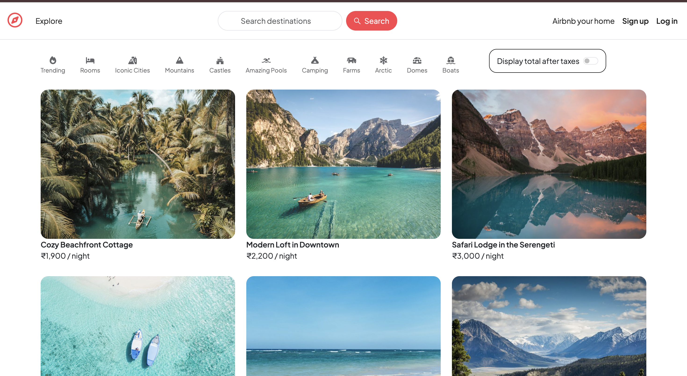
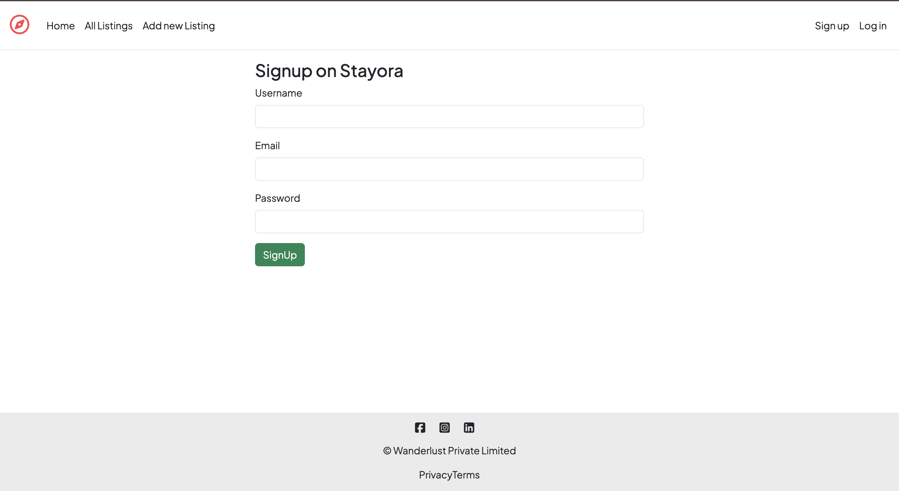
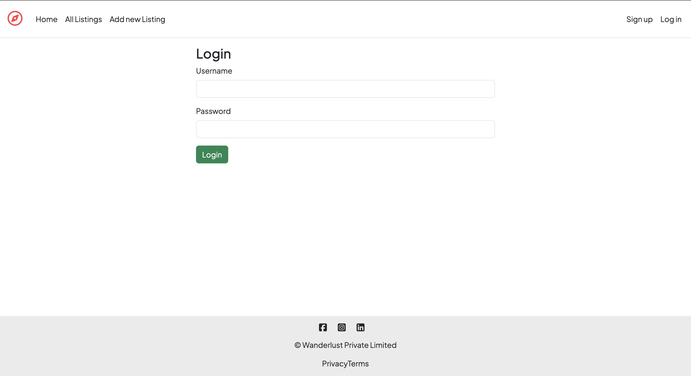
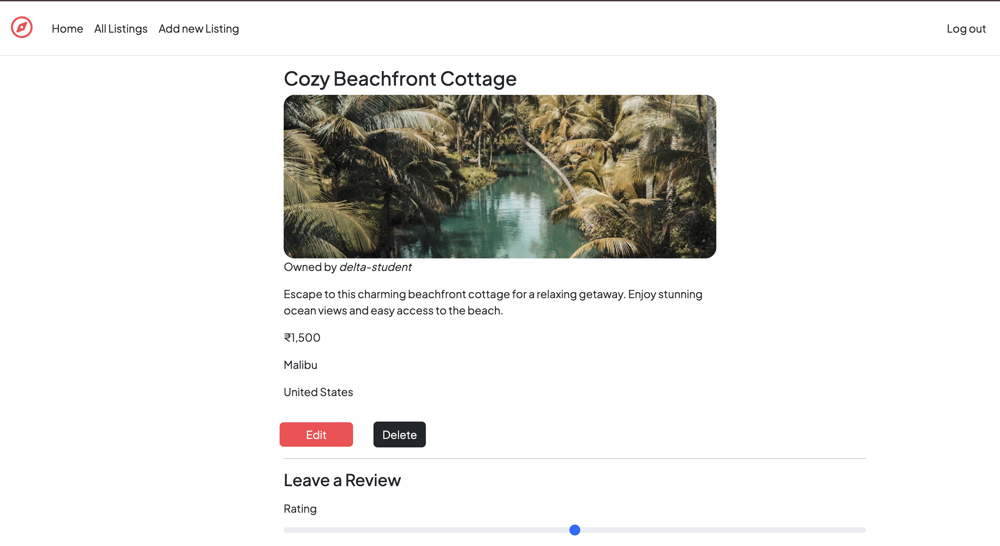
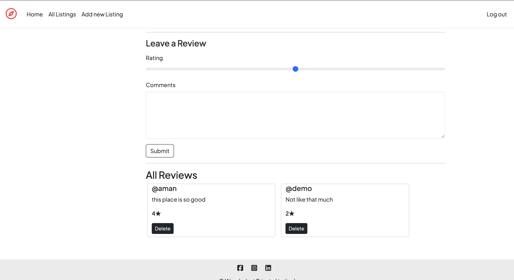
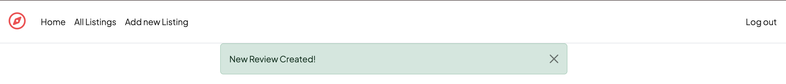
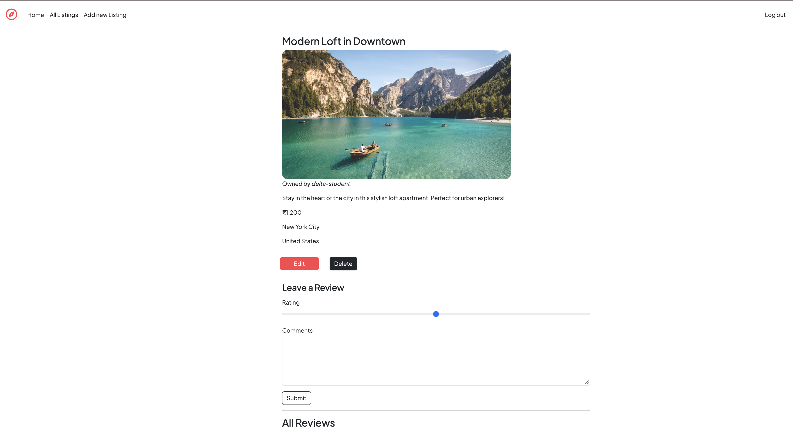

🏡 Stayora — Full-Stack Property Rental Platform

Stayora is a full-stack property rental web application inspired by modern vacation-rental platforms. Users can explore property listings, view listing details, manage their own listings, authenticate securely, and share reviews and ratings.

🌐 Live Demo: https://stayora-yhq0.onrender.com
💻 GitHub Repository: https://github.com/ShreyanshM1/Stayora

⸻

✨ Features

🔐 Authentication & Authorization

* User signup, login, and logout
* Passport.js authentication
* Session management using Express-session
* Cookie-based session handling
* Protected routes for authenticated users
* Ownership-based authorization for listings and reviews
* Flash messages for success and error feedback

🏠 Property Listings

* Browse available property listings
* View individual listing details
* Create new listings
* Edit and delete your own listings
* Listing ownership verification

⭐ Reviews & Ratings

* Add reviews to property listings
* Rate properties
* Display reviews on listing detail pages
* Delete reviews
* Review ownership authorization

🎨 User Interface

* Responsive interface built with Bootstrap
* Dynamic server-rendered pages using EJS
* Reusable navigation bar and footer
* Flash messages for user feedback
* Form validation and error handling

⸻

🛠️ Tech Stack

Technology	Purpose
Node.js	JavaScript runtime
Express.js	Backend framework and routing
MongoDB	Database
Mongoose	Database modeling and operations
EJS	Server-side templating
EJS-Mate	Layouts and reusable templates
Passport.js	Authentication
Express-session	Session management
Bootstrap	Responsive UI styling
HTML, CSS, JavaScript	Frontend development
Git & GitHub	Version control

⸻

🧠 Key Technical Implementations

* RESTful routing and MVC-style organization
* CRUD operations for property listings and reviews
* Authentication using Passport.js
* Authorization using custom Express middleware
* Session and cookie management
* Protected routes and ownership-based access control
* MongoDB integration using Mongoose
* Dynamic server-side rendering with EJS
* Reusable layouts and partial templates
* Form validation and centralized error handling

⸻

## 📸 Screenshots

### 🏠 Home / Listings

### 🔐 Signup

### 🔑 Login

### 🏡 Listing Details

### ⭐ Reviews

### 💬 Flash Messages

### ✏️ Edit Listing

⸻

🚀 Getting Started

Follow these steps to run Stayora locally.

1. Clone the repository

git clone https://github.com/ShreyanshM1/Stayora.git
cd Stayora

2. Install dependencies

npm install

3. Configure environment variables

Create a .env file in the project root and configure the environment variables required by your application.

For example:

ATLASDB_URL=your_mongodb_connection_string
SECRET=your_session_secret

Use the exact variable names expected by your code. If your application requires additional environment variables, configure those too.

Important: Never commit your actual database credentials, session secrets, or other sensitive environment variables to GitHub.

4. Start the application

Run the command configured in your package.json. If your project uses Nodemon with the app.js entry point, you can typically run:

npm start

If no start script is configured, use the appropriate command for your project, such as:

node app.js

Open the local address displayed by your application.

⸻

📁 Project Structure

Stayora/
├── init/
├── models/
├── public/
├── routes/
├── screenshots/
├── utils/
├── views/
│   ├── includes/
│   ├── layouts/
│   ├── listings/
│   └── users/
├── app.js
├── middleware.js
├── package.json
├── package-lock.json
└── README.md

⸻

📚 What I Learned

Developing and deploying Stayora helped me gain practical experience with:

* Full-stack web application development
* RESTful APIs and Express routing
* MongoDB database operations
* Authentication and authorization
* Session management and cookies
* Express middleware and protected routes
* EJS templating and reusable layouts
* CRUD operations and form validation
* Error handling and user feedback
* Version control with Git and GitHub
* Deploying a web application

⸻

👨‍💻 Author

Shreyansh Mishra

* GitHub: https://github.com/ShreyanshM1

⸻

⭐ If you find this project interesting, consider giving the repository a star!